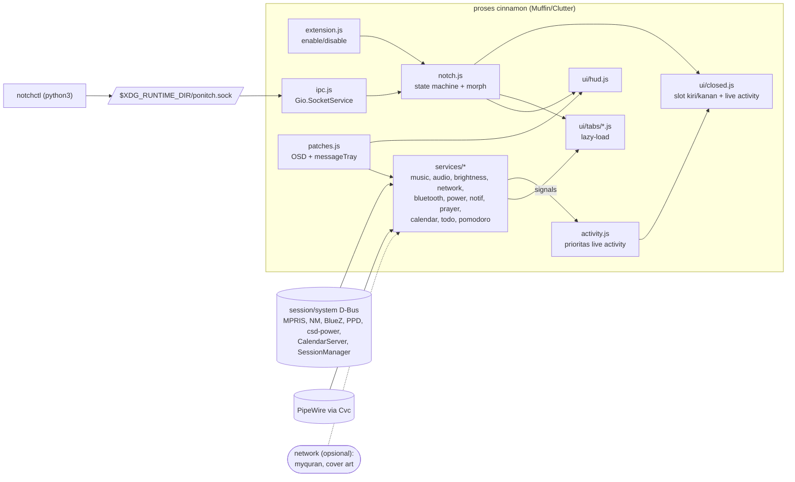
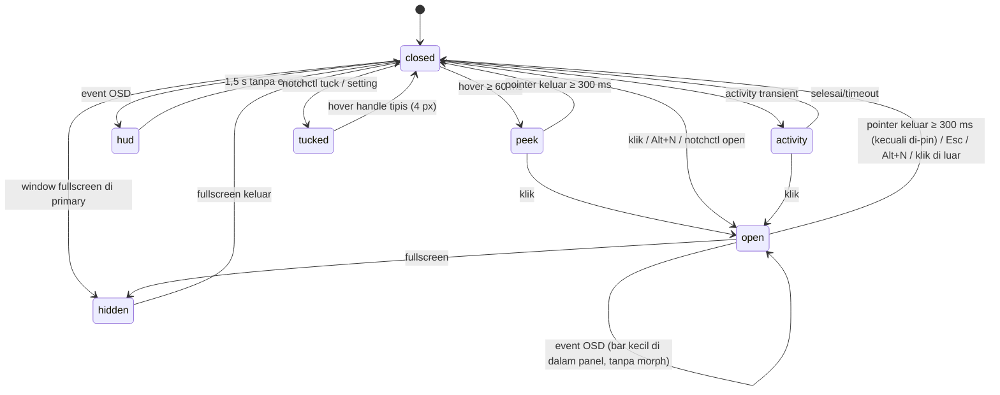

# ponitch: PLAN.md

Notch interaktif yang ringan untuk desktop Linux berbasis **Cinnamon** dan **GNOME Shell** (Linux Mint, Ubuntu, dan distro lain), terinspirasi Poni (Windows), dengan desain ala notchy.dev.
Status: **M0–M4 dan M6 selesai di Cinnamon** (2026-11-05). **M5 (Calendar) di-drop**. **MG selesai** (GNOME 46, uji nested 2026-11-09; GNOME lalu dicopot dari mesin pengembang atas permintaan user, uji GNOME berikutnya di VM). **M7**: i18n selesai (Indonesia); rilis GitHub/EGO/Spices belum.

> Nama `ponitch`. UUID extension: `ponitch@masahhmad`. Repo: `github.com/masahhmad/ponitch` (belum dibuat). Lisensi: **GPL-3.0-or-later**.

**Revisi 2** (keputusan user):
1. Fitur blur/frosted **dihapus**.
2. Calendar **memakai kalender yang sudah ada** di Cinnamon. Tidak ada pengaturan iCal sendiri.
3. Fitur Claude Code **dihapus**.

**Revisi 3** (jawaban pertanyaan terbuka):
1. Config memakai **settings-schema Cinnamon**.
2. Panel dipindah ke bawah **oleh user sendiri**.
3. Shortcut `Alt+N` aman.
4. File adzan disediakan user nanti (setting path file).
5. **Cuaca & lirik di-drop.**
6. **Selalu dark**, jadi toggle dark mode di-drop.

**Revisi 5** (proyek untuk umum, bukan hanya mesin ini):
1. Target **Cinnamon + GNOME Shell 46+** (GNOME 46 = Ubuntu 24.04 LTS, versi yang paling banyak dipakai). KDE dan desktop lain ditunda.
2. **Satu basis kode inti + adapter tipis per desktop**, dirilis sebagai dua extension. Detail di **§2A**.
3. UUID `ponitch@masahhmad`, lisensi GPL-3.0-or-later, UI berbahasa Inggris + terjemahan (Indonesia termasuk).
4. Jadwal sholat mendukung metode internasional; Kemenag/myquran tetap untuk lokasi Indonesia (§4.6).
5. Bagian §1 dan §2 tetap berisi hasil deteksi mesin pengembang (Mint/Cinnamon) sebagai catatan; arah multi-desktop ada di §2A.

**Revisi 4**: desain, efek membesar/mengecil, dan tata letak **meniru notchy.dev** (dicek di Chrome + source bundle situsnya, 2026-11-04). Spesifikasi lengkapnya di **§4A**, yang mengalahkan ukuran/animasi lama di §4.1, §4.7 dan §5.

---

## 1. Hasil deteksi environment & implikasinya

Hasil perintah read-only pada 2026-11-04:

| Item | Hasil | Implikasi |
|---|---|---|
| Distro | Linux Mint 22.3 "Zena" (basis Ubuntu 24.04) | Paket apt Ubuntu noble; Qt 6.4.2 (terlalu tua untuk Quickshell, yang butuh ≥ 6.6) |
| DE / WM | **Cinnamon 6.6.9**, Muffin 6.6.3 (compositing WM) | Shell berbasis **CJS + St + Clutter**, sama seperti GNOME Shell. Extension berjalan **di dalam proses `cinnamon`** |
| Session | **X11** (`XDG_SESSION_TYPE=x11`) | **Tidak ada wlr-layer-shell.** Quickshell PanelWindow/AGS/gtk4-layer-shell tidak relevan. Shortcut global bisa didaftarkan langsung (tanpa bind compositor) |
| Monitor | eDP-1 1920×1080 @ x=1920 (**primary**, laptop); DP-1 panel 1440×900 di-*transform* ×1.333 → logis 1920×1200 @ x=0 | Fractional scaling X11 aktif. Notch hanya di **primary** (keputusan user). DPI 84 |
| Panel | 1 panel **atas** di monitor 0, tinggi 39 px, applet kalender di tengah | Keputusan user: **panel dipindah ke bawah** agar notch nempel di tepi atas seperti Poni |
| Notifikasi | `org.freedesktop.Notifications` dimiliki **proses cinnamon sendiri** (`notificationDaemon.js` + `messageTray.js`) | Tidak perlu mengganti daemon. Extension mencegat `Main.messageTray._onNotify` di dalam proses |
| OSD | `Main.osdWindowManager.show(monitorIndex, icon, label, level)`; gsettings `org.cinnamon show-media-keys-osd` | HUD notch cukup monkey-patch `show()`, OSD bawaan otomatis tidak dobel |
| Audio | PipeWire + WirePlumber aktif | Cinnamon memakai `Cvc` (libgvc) yang sudah ada di proses. Event-driven |
| Network | NetworkManager aktif | `NM` GI (libnm) sudah dipakai `network@cinnamon.org` |
| Bluetooth | BlueZ aktif | D-Bus `org.bluez` (ObjectManager + `Battery1`) |
| Power profile | power-profiles-daemon aktif (`power-saver`) | D-Bus `net.hadess.PowerProfiles` |
| Brightness | `intel_backlight`; csd-power mengekspos `org.cinnamon.SettingsDaemon.Power.Screen` | Tanpa root, tanpa brightnessctl: properti `Brightness` + `StepUp/StepDown` + `PropertiesChanged` |
| Idle inhibit | `org.gnome.SessionManager` (dipakai `inhibit@cinnamon.org`) | `Inhibit()` / `Uninhibit()` |
| Dark mode | `org.x.apps.portal color-scheme = 'prefer-dark'`, tema `Space-dark` | Sistem sudah dark; notch selalu dark, tanpa toggle |
| Kalender | `org.cinnamon.CalendarServer` (di atas Evolution Data Server) dipakai applet kalender Cinnamon. Saat ini hanya kalender lokal "system" EDS | ponitch **membaca sumber yang sama** dengan applet kalender. Kalender baru (Google dll.) ditambahkan user lewat cara biasa (GNOME Online Accounts / Evolution / GNOME Calendar) dan otomatis ikut muncul |
| MPRIS | Kode MPRIS lengkap ada di `sound@cinnamon.org/applet.js` | Pola yang bisa ditiru |
| Tools absen | `playerctl`, `brightnessctl`, `cava`, `sqlite3`, `cargo`, `quickshell`, `ags` | Tidak dibutuhkan (cava hanya untuk visualizer opsional) |
| Extension user | `Flipper@connerdev`, `transparent-panels@germanfr` | Cek tampilan `transparent-panels` setelah panel dipindah |
| RAM `cinnamon` | RSS ~179 MB (baseline sekarang) | Budget extension diukur sebagai **delta** di atas baseline ini |

**Kesimpulan:** di Cinnamon/X11 cara paling ringan adalah **extension Cinnamon**. Ia memakai scene graph Clutter (GPU), input region, deteksi fullscreen, keybinding, OSD, notifikasi, dan kalender yang sudah ada di proses shell. Tidak ada proses kedua, tidak ada toolkit kedua di RAM.

---

## 2. Evaluasi stack

Kriteria dinilai **untuk Cinnamon 6.6 X11**.

| | RAM idle (perkiraan) | CPU idle | Posisi dan input region / click-through | Transparansi | Animasi morph | D-Bus | Ekosistem / maintainability | Cocok? |
|---|---|---|---|---|---|---|---|---|
| **(a) Quickshell / QML** | 60–120 MB | ~0 | Layer-shell hanya Wayland; X11 terbatas | Alpha | Sangat bagus | Bagus | Butuh Qt ≥ 6.6, Mint 6.4.2 → **build Qt sendiri** | ❌ |
| **(b) Rust + GTK4 (+ layer-shell)** | 25–40 MB | ~0 | Layer-shell tidak ada di X11. GTK4 menghapus API type-hint/input-shape → XShape manual | Alpha | Manual (tick callback) | zbus | Rust belum terpasang; banyak kode X11 manual | ⚠️ |
| (b′) Python/C + **GTK3** override-redirect | Python 45–70 MB / C 15–25 MB | ~0 | `input_shape_combine_region` + `DOCK` hint: OK | Alpha | Cairo di CPU | Gio | Proses terpisah: harus mereplikasi OSD/notif/fullscreen | ⚠️ |
| **(c) AGS / Astal** | 40–80 MB | ~0 | Bergantung layer-shell (Wayland) | — | Bagus | Bagus | Target Hyprland/Wayland | ❌ |
| **(d) Tauri** (pembanding) | 80–150 MB (WebKitGTK) | Tidak benar-benar 0 | Manual | CSS | CSS | Lewat Rust | Berat | ❌ |
| **(e) Extension Cinnamon** | **+5–15 MB delta** (target ≤ 20 MB) | **0** | `Main.layoutManager.addChrome(actor, {affectsInputRegion, visibleInFullscreen})`: region mengikuti ukuran actor → click-through gratis | Alpha (warna rgba) | `actor.ease()` Clutter di GPU | Gio.DBus native; NM, Cvc, CalendarServer proxies sudah ada | CJS seperti applet Cinnamon; reload tanpa logout; debug via Looking Glass | ✅ |

**Keputusan: (e) extension Cinnamon (CJS/St/Clutter).**

Alasan:
1. **Proses tambahan = 0**, delta RAM paling kecil.
2. Click-through, fullscreen auto-hide, shortcut global, pengganti OSD, intercept notifikasi, dan kalender adalah **API yang sudah ada**.
3. Animasi di-render compositor, **tanpa repaint saat idle**.

**Risiko & mitigasi:**
- Bug extension bisa mengganggu Cinnamon. Di X11 Cinnamon auto-restart; `Ctrl+Alt+Esc` me-restart shell. Semua callback di `try/catch`, semua I/O async, tiap service bisa di-disable.
- API internal Cinnamon (`_onNotify`, `osdWindowManager.show`) bisa berubah antar versi. Semua patch ada di satu file `patches.js` dengan guard dan restore saat `disable()`; `cinnamon-version` dibatasi `["6.4","6.6"]`.

---

## 2A. Dukungan multi-desktop (Cinnamon + GNOME)

### Target
| Desktop | Versi | Distro contoh | Status |
|---|---|---|---|
| Cinnamon | 6.6 (diuji); target 6.0+ (seluruh Mint 22.x) setelah diuji di VM | Linux Mint, Ubuntu Cinnamon, Fedora Cinnamon | M0 jalan |
| GNOME Shell | **46+** (46 = Ubuntu 24.04 LTS, 49 = Ubuntu 25.10) | Ubuntu, Fedora, Debian 13 | milestone **MG** |
| KDE Plasma, Xfce, dll. | — | Kubuntu, Xubuntu | ditunda; butuh pendekatan lain (aplikasi layer-shell / widget Plasma) |

Kenapa tetap extension (bukan satu aplikasi lintas desktop): GNOME Wayland tidak mengizinkan aplikasi biasa membuat window yang selalu di atas, berposisi tetap, dan tembus klik. Mengganti OSD dan mencegat notifikasi juga hanya bisa dari dalam shell. Bonusnya, tetap **0 proses tambahan** di kedua desktop.

### RAM
Pengguna hanya memasang **satu** extension (milik desktopnya). Kode adapter desktop lain tidak pernah dimuat, jadi dukungan dua desktop tidak menambah RAM. Budget §6 berlaku sama untuk keduanya. Angka GNOME diukur di VM saat MG.

### Cara berbagi kode
- `src/core/`: kode netral platform. **Tidak boleh** memakai `imports.*`, `import`, `Main`, atau `global`. Library GI dan objek shell **disuntikkan** lewat objek `platform` dari adapter. Format modul: `require('./x')` + satu baris `module.exports = { ... }` di akhir (format bawaan Cinnamon; bisa langsung dites dengan node).
- `src/cinnamon/`: adapter Cinnamon (`extension.js`, `metadata.json`, `settings-schema.json`).
- `src/gnome/`: adapter GNOME (`extension.js` ESM, `prefs.js` Adw, `schemas/*.gschema.xml`, `metadata.json` dengan `shell-version` 46–49).
- `src/stylesheet.css`: dipakai keduanya.
- `build.py` menghasilkan `dist/cinnamon/ponitch@masahhmad/` (core apa adanya) dan `dist/gnome/ponitch@masahhmad/`. Untuk GNOME, `const { A } = require('./x');` diubah jadi `import { A } from './x.js';` dan `module.exports = { A };` jadi `export { A };`. **Build gagal** jika masih tersisa `require(` atau `module.exports` di output GNOME.

### Antarmuka `platform` (disediakan adapter)
| Kebutuhan core | Cinnamon 6.6 | GNOME 46+ |
|---|---|---|
| Format modul | `require` / `module.exports` (fileUtils.requireModule) | **ESM wajib** (terverifikasi, gjs.guide) |
| Pasang ke layar | `addChrome(a, {visibleInFullscreen:false})` | `addChrome(a, {trackFullscreen:true})` (terverifikasi, layout.js gnome-46) |
| Monitor | `Main.layoutManager.primaryMonitor` + `monitors-changed` | sama (terverifikasi) |
| Skala UI | `global.ui_scale` + `notify::ui-scale` | `St.ThemeContext.get_for_stage(global.stage).scale_factor` + `notify::scale-factor` |
| Frame timeline | `Clutter.Timeline` tanpa actor (pola tweener Cinnamon) | `Clutter.Timeline({actor})`; diverifikasi di MG |
| Shortcut | `Main.keybindingManager.addHotKey` | `Main.wm.addKeybinding` + key GSettings bertipe `as` |
| Pengaturan | `settings-schema.json` (GUI otomatis) | GSettings + `prefs.js` (Adw) |
| OSD (M0.5) | `osdWindowManager.show(mon, icon, label, level, convertIndex)` | `show(mon, icon, label, level, maxLevel)` (terverifikasi, osdWindow.js gnome-46) |
| Volume (M2) | `Cvc` | `Gvc` |
| Brightness (M2) | `org.cinnamon.SettingsDaemon.Power.Screen` | 46: `org.gnome.SettingsDaemon.Power.Screen`; versi lebih baru berubah, diverifikasi di M2 |
| Kalender (M5) | `org.cinnamon.CalendarServer` | `org.gnome.Shell.CalendarServer` (diverifikasi di M5) |
| Notifikasi (M4) | patch `messageTray._onNotify` | MessageTray GNOME, internal berbeda (diverifikasi di M4) |
| Suara | `global.play_sound_file` | `global.display.get_sound_player()` (diverifikasi saat dipakai) |
| Alignment `St.Bin`/`St.Button` | properti `x_align`/`y_align` bertipe `St.Align` dan mengatur posisi **anak** (terverifikasi di M1) | `Clutter.ActorAlign`, mengatur posisi widget itu sendiri | 

**Aturan core** (dipelajari di M1–M2, berlaku untuk semua kode bersama):
- Jangan set `x_align`/`y_align` pada turunan `St.Bin` (`St.Button`, `St.ScrollView`); bungkus dengan `St.BoxLayout` (`centered()` di `widgets.js`).
- Isi `St.ScrollView` lewat `setScrollChild()`: Cinnamon wajib `add_actor()` (`set_child()` membuat Cinnamon abort di `st_bin_destroy` saat view dihancurkan; terjadi di uji M2), GNOME 46 hanya punya `set_child()`.
- Putus sinyal lewat `disconnectAll()` (= `GObject.signal_handler_disconnect`), bukan `obj.disconnect(id)`: `NM.Device.disconnect()` adalah "putuskan perangkat dari jaringan".
- Jangan baca `actor.width` sebelum actor punya alokasi (St memberi peringatan theme node); cek `has_allocation()`.
- Brightness: Cinnamon = method `GetPercentage`/`SetPercentage` + sinyal `Changed` (terverifikasi), GNOME 46 = properti `Brightness`.
- Daftar yang dibangun ulang dari handler klik memakai `deferred()`: jangan hancurkan tombol yang sedang memancarkan `clicked`.
- `set_style(null)`, bukan `set_style('')` (St tidak bisa mem-parse style kosong).
- Tulis berkas data hanya lewat `writeJson()` (satu penulisan per berkas, nilai terbaru menang). Penulisan async yang tumpang tindih sempat menghilangkan todo saat uji.
- Keyboard di dalam notch hanya lewat `platform.grabKeyboard()`; di Cinnamon lepas modal **hanya** bila actor masih ada di `Main.modalActorFocusStack` (`popModal` actor asing mengakhiri modal apa pun).

Fitur yang tidak bisa dibuat setara di salah satu desktop disembunyikan di desktop itu, bukan diakali.

### GNOME: konflik dengan top bar
Top bar GNOME selalu di atas dengan jam di tengah, persis di tempat notch. Rencana default: notch **menutupi tengah top bar** dan jam/menu tanggal **dipindah ke kanan** (seperti menu bar Mac dengan notch). Pilihan lain lewat setting: notch di bawah top bar. Lihat pertanyaan terbuka §9.

### Untuk pengguna umum
- **Bahasa**: UI default Inggris, gettext domain `ponitch@masahhmad` (= UUID: Cinnamon dan GUI Settings-nya mencari terjemahan xlet dengan nama itu), terjemahan Indonesia ikut dirilis.
- **Sholat**: metode perhitungan bisa dipilih (Kemenag, MWL, ISNA, Mesir, Umm al-Qura, Karachi, JAKIM, MUIS, dll.) + mazhab Ashar + koreksi menit. API myquran hanya untuk lokasi Indonesia (§4.6). Tanpa lokasi default: saat pertama kali, notch meminta lokasi diatur.
- **Distribusi**: GitHub release (zip per desktop), extensions.gnome.org, Cinnamon Spices.
- **Matriks uji**: Mint 22.3 Cinnamon 6.6 (mesin ini), VM Ubuntu 24.04 (GNOME 46), VM Ubuntu 25.10 (GNOME 49).

---

## 3. Arsitektur



### Struktur repo

```
ponitch/
├── PLAN.md  README.md  LICENSE (GPL-3.0)
├── build.py                   # src/ → dist/cinnamon, dist/gnome
├── install.sh  uninstall.sh   # deteksi desktop, build, symlink ke folder extension yang benar
├── src/
│   ├── stylesheet.css
│   ├── core/                  # netral platform (lihat §2A)
│   │   ├── spring.js  notch.js  ipc.js
│   │   ├── activity.js  store.js                      (M1+)
│   │   ├── ui/ closed.js hud.js tabs/*.js             (M0.5+)
│   │   └── services/ music.js network.js bluetooth.js power.js prayer.js praytimes.js todo.js pomodoro.js  (M1+)
│   ├── cinnamon/
│   │   ├── extension.js  metadata.json  settings-schema.json
│   │   └── platform.js        # Main/global/Cvc/csd-power/CalendarServer/messageTray untuk core
│   └── gnome/                 (MG)
│       ├── extension.js  prefs.js  metadata.json  platform.js
│       └── schemas/org.gnome.shell.extensions.ponitch.gschema.xml
├── po/                        # ponitch.pot + id.po (M7)
├── bin/notchctl               # python3, stdlib saja
├── dist/                      # hasil build (tidak di-commit)
└── tests/
    ├── test_spring.js  test_build.py
    ├── test_praytimes.js  fixtures/          (M3)
```

### Konvensi

- **Service** = class dengan `start()` / `stop()` dan sinyal. `start()` baru meng-subscribe D-Bus. Service yang di-disable **tidak pernah di-`start()`**, sehingga tidak ada proxy dan tidak ada timer.
- **Tab** di-`import` saat pertama dibuka (lazy). Actor tab di-`destroy()` 30 s setelah notch ditutup.
- **Config**: core hanya melihat objek `cfg` biasa + callback `applyConfig()`. Cinnamon mengisinya dari `settings-schema.json` (GUI otomatis), GNOME dari GSettings + `prefs.js`. Nama key sama di keduanya.
- **Data**: `~/.local/share/ponitch/{todos.json, notifications.jsonl, pomodoro.json}`. Cache: `~/.cache/ponitch/{prayer-<id>-<yyyy-mm>.json, art/}`. Tulis atomik (`replace_contents`).
- **IPC**: `$XDG_RUNTIME_DIR/ponitch.sock` (0600), satu baris JSON per request: `{"cmd":"toggle"}`, `{"cmd":"open","tab":"music"}` (`notchctl open music`), `{"cmd":"tuck"}`.
- **Shortcut**: default `<Alt>n`, didaftarkan adapter (§2A). `notchctl toggle` tetap ada untuk skrip.
- **Autostart**: extension di-load otomatis oleh shell. Tidak perlu systemd.
- **Privasi**: tanpa telemetri. Network hanya myquran (1×/bulan) dan cover art `http(s)` dari MPRIS. Sinkronisasi kalender ditangani EDS, bukan ponitch.

---

## 4. Spesifikasi per fitur

Format: **Closed** · **Open** · **Data** · **Event** · **Config** · **Edge case**.

### 4.1 Dashboard
Beda dengan Control: **Dashboard = baca saja / info waktu** (yang terjadi sekarang dan berikutnya). **Control = saklar perangkat**. Satu-satunya kontrol di Dashboard: play/pause mini player dan start/pause pomodoro.
- **Closed**: slot kiri/kanan pilihan: `battery | date | next-prayer | next-event | next-task | timer | album-art | none`; tengah: jam `HH:MM`.
- **Open**: tab **Home** dengan grid ala Notchy (§4A.5): mini player | sholat berikutnya | pomodoro, lalu kalender bulan | "Up next" (event + todo hari ini). Tanggal Hijriah di judul kartu sholat (`Intl.DateTimeFormat('id-u-ca-islamic-umalqura')`, cek dukungan ICU di CJS).
- **Data**: agregasi service lain.
- **Event**: jam memakai **satu** timeout yang di-align ke pergantian menit. Detik hanya berdetak saat countdown < 1 jam **terlihat**.
- **Config**: `slot-left`, `slot-right`.
- **Edge**: resume dari suspend → `org.freedesktop.login1.Manager.PrepareForSleep(false)` → hitung ulang semua timer.

### 4.2 Music
- **Closed**: cover kecil kiri + indikator equalizer kecil kanan. Track ganti → live activity 4 s: cover + judul.
- **Open**: cover besar dengan **glow warna dominan**, judul/artis, progress + seek, prev/play-pause/next, pemilih player bila > 1.
- **Data**: MPRIS `org.mpris.MediaPlayer2.Player`: `PlaybackStatus`, `Metadata` (`xesam:title`, `xesam:artist`, `mpris:artUrl`, `mpris:length`, `mpris:trackid`), `Position`, `Rate`, `CanSeek`, `PlayPause/Next/Previous/SetPosition(trackid, pos)`, sinyal `Seeked`.
- **Event**: `NameOwnerChanged` untuk `org.mpris.MediaPlayer2.*`, lalu `PropertiesChanged`. `Position` tidak dipancarkan (sesuai spec), jadi progress dihitung lokal dari `Position` + `Rate` × waktu, sinkron ulang saat `Seeked` atau status berubah. Ticker **hanya saat tab Music terbuka**.
- **Warna dominan**: decode cover 16×16 (`GdkPixbuf.new_from_file_at_scale`), rata-rata piksel jenuh, cache per URL.
- **Cover**: `file://` langsung; `https://` diunduh async (Soup 3) ke `~/.cache/ponitch/art/<sha1>`, LRU 50.
- **Visualizer (opsional, default off)**: `cava` raw output, hanya saat tab Music terbuka dan Playing. Tersembunyi jika cava tidak terpasang.
- **Config**: `music-enabled`, `music-preferred-players`, `music-visualizer`.
- **Edge**: banyak instance browser → pilih yang Playing terakhir; tanpa `artUrl` → ikon default; player mati → fallback ke player lain.

### 4.3 Control
- **Closed**: tidak ada (muncul sebagai HUD, §4.9).
- **Open**: grid: Wi-Fi (SSID + daftar jaringan saat diklik), Bluetooth (perangkat + baterai), slider volume + mute output + mute mic, slider brightness, Keep awake, Power profile (3 segmen), Lock, DND ponitch.
- **Data / API**:
  - Wi-Fi: `NM.Client` (async): `wireless_enabled`, `activate_connection_async`, AccessPoint list. **Scan hanya saat panel Wi-Fi dibuka**.
  - Bluetooth: `org.bluez` ObjectManager: `Adapter1.Powered`, `Device1.Connected/Alias/Icon`, `Battery1.Percentage`.
  - Audio: `Cvc.MixerControl` (`default-sink-changed`, `notify::volume`/`notify::is-muted`).
  - Brightness: `org.cinnamon.SettingsDaemon.Power.Screen` properti `Brightness` + `PropertiesChanged`. DDC/CI monitor eksternal **di luar scope**.
  - Keep awake: `org.gnome.SessionManager.Inhibit(app_id, 0, reason, 8)`.
  - Power profile: `net.hadess.PowerProfiles.ActiveProfile` (system bus).
  - Lock: `org.cinnamon.ScreenSaver.Lock`.
- **Config**: `control-enabled`.
- **Edge**: tanpa adaptor Bluetooth / tanpa PPD → tile disembunyikan; rfkill.

### 4.4 Calendar (kalender yang sudah ada) — DI-DROP 2026-11-05 (keputusan user; "Up next" di Home hanya berisi todo)
- **Prinsip**: ponitch **tidak mengelola kalender sendiri**. Ia membaca event yang sama dengan applet kalender Cinnamon, lewat `org.cinnamon.CalendarServer` (di atas Evolution Data Server). Kalender yang ditambahkan user di EDS (lokal, Google lewat Online Accounts, webcal) otomatis ikut. Tidak ada pengaturan URL, OAuth, cache, atau parser RRULE di ponitch.
- **Closed**: slot `next-event` ("Rapat · 14:00"); live activity 10 menit sebelum event ("Rapat dalam 9 mnt").
- **Open**: agenda 7 hari ke depan per hari, dengan titik warna kalender.
- **Data** (terverifikasi dari introspeksi + `eventView.js` applet):
  - Method `SetTimeRange(x since, x until, b force_reload)`.
  - Sinyal `EventsAddedOrUpdated(a(sssbxxx))` dengan field `[id, color, summary, all_day, start_time, end_time, mod_time]`.
  - Sinyal `EventsRemoved(s ids)` dan `ClientDisappeared(s source_uid)`.
  - Properti `Since` / `Until` / `Status`.
- **Event**: sinyal di atas. Pengingat: satu timeout ke event terdekat (dijadwal ulang saat data berubah atau resume).
- **Risiko berbagi server**: CalendarServer punya **satu** rentang waktu untuk semua klien. Bila ponitch memanggil `SetTimeRange`, rentang applet kalender ikut berubah (dan sebaliknya). Mitigasi: baca `Since/Until`, panggil `SetTimeRange` hanya untuk **memperluas** agar mencakup hari ini s/d +7 hari, dan simpan event yang diterima per id. Perilaku saat applet membuka bulan lain **diuji di M5**.
- **Config**: `calendar-enabled`, `calendar-remind-min` (10).
- **Edge**: event seharian; CalendarServer belum aktif (activatable, dijalankan otomatis saat proxy dibuat); tanpa kalender → slot kosong.

### 4.5 Todo
- **Closed**: slot `next-task` dengan countdown due terdekat; live activity saat due < 15 menit atau lewat (merah).
- **Open**: input cepat ("judul @15:30" / "besok 09:00"), list hari ini / mendatang / selesai, centang, hapus.
- **Data**: `~/.local/share/ponitch/todos.json` `[{id, title, due?, done, created}]`. JSON karena CJS tidak punya binding SQLite tanpa dependency baru.
- **Event**: satu timeout ke due terdekat.
- **Edge**: tulis atomik; parser waktu Indonesia minimal (`HH:MM`, `besok`).

### 4.6 Prayer Times
- **Closed**: slot `next-prayer` ("Ashar 14:30"); live activity 15 menit sebelum ("Maghrib −12:04") dan 5 menit setelah masuk ("Waktu Isya").
- **Open**: 5 waktu + imsak/terbit/dhuha, highlight berikutnya, lokasi, sumber (Kemenag API / Offline), toggle adzan.
- **Perbandingan**:
  | | (a) Hitung offline | (b) api.myquran.com |
  |---|---|---|
  | Akurasi | Parameter Kemenag: Subuh 20°, Isya 18°, Ashar Syafi'i ×1, ihtiyath ~2 mnt, imsak = Subuh − 10 mnt | **Data resmi Bimas Islam** per kab/kota |
  | Network | Tidak ada | Sekali per bulan |
  | Lokasi | Lat/lon bebas | ID kota |
- **Rekomendasi**: (b) **API sebagai sumber utama**, di-cache sebulan; (a) offline sebagai fallback. Alasannya, API adalah jadwal resmi Kemenag, dan setelah di-cache praktis offline. **Fixture myquran dipakai sebagai test oracle** untuk hitungan offline (toleransi ±2 mnt).
- **API terverifikasi** (2026-11-04):
  - `GET https://api.myquran.com/v2/sholat/kota/cari/{keyword}` → `{data:[{id:"1638", lokasi:"KOTA SURABAYA"}]}`
  - `GET https://api.myquran.com/v2/sholat/jadwal/{id}/{yyyy}/{mm}` → `data.jadwal[] {date, imsak, subuh, terbit, dhuha, dzuhur, ashar, maghrib, isya}`
  - Surabaya 2026-11-01: subuh 03:44, dzuhur 11:16, ashar 14:30, maghrib 17:27, isya 18:38.
- **Lokasi bisa diubah**: Settings → "Cari kota" (endpoint cari, lalu simpan `prayer-city-id` + `prayer-city-name`) + `prayer-lat`/`prayer-lon` untuk offline. Tidak ada default lokasi untuk rilis publik; di mesin pengembang dipakai Surabaya (1638, −7.2575, 112.7521).
- **Pengguna di luar Indonesia** (Revisi 5): hitung offline dengan metode pilihan (`prayer-method`: kemenag, mwl, isna, egypt, umm-al-qura, karachi, jakim, muis, dll.), `prayer-asr` (syafii/hanafi), dan koreksi menit per waktu. Sudut tiap metode diverifikasi terhadap sumber resminya saat M3. API myquran hanya dipakai bila lokasi di Indonesia.
- **Event**: satu timeout ke waktu berikutnya; fetch bulan baru di tanggal 1 atau saat cache tidak ada.
- **Adzan (opsional, off)**: setting `prayer-adzan-file` (file chooser di settings-schema), diputar via `global.play_sound_file`. Tidak ada file bawaan; user menyediakan sendiri. Path kosong/tidak ada → tanpa suara. Hormati DND (§4.10).
- **Edge**: ganti bulan tengah malam; jam sistem berubah / resume; API down → offline.

### 4.7 Your look (tanpa blur)
- Mode warna: `black` (default, `#000`), `custom` (color picker, solid), `glass` (warna + alpha, mis. `rgba(0,0,0,0.6)`). Semuanya hanya warna rgba: **tanpa efek blur**, tanpa render pass tambahan.
- Bentuk: `attached` (menempel tepi atas, sudut bawah membulat, "telinga" cekung di sudut atas) vs `floating` (±6 px di bawah tepi, semua sudut membulat). Detail dan bayangan: §4A.2 dan §4A.6.
- Ukuran, bentuk, warna, bayangan: **lihat §4A** (tabel ukuran per state ala Notchy). `attached` = bentuk "notch" Notchy, `floating` = bentuk "pill" Notchy. Semua logical px × `global.ui_scale`.
- **Selalu dark**: teks/ikon putih di atas notch gelap; tidak ada varian light.
- Font: sistem, angka `font-feature-settings: "tnum"` agar countdown tidak bergoyang. Ikon: `-symbolic`.

### 4.8 Notifikasi di notch
- **Keputusan user**: notch **menggantikan banner** bawaan; riwayat applet `notifications@cinnamon.org` tetap jalan.
- **Perbandingan**: menjadi server `org.freedesktop.Notifications` mustahil tanpa melawan Cinnamon (nama itu milik proses cinnamon). Monitor D-Bus pasif tidak bisa menyembunyikan banner dan tidak memberi objek actions. **Intercept in-process** paling sederhana dan lengkap.
- **Mekanisme**: patch `Main.messageTray._onNotify(source, notification)`. Notifikasi dikirim ke notch, banner bawaan tidak ditampilkan, tetapi tetap masuk ke applet notifikasi. Cara persisnya diverifikasi di M4 terhadap `messageTray.js` baris 862–1090 (jalur `extensionsHandlingNotifications` / `notify-applet-update`). Restore saat disable.
- **Closed**: live activity ikon app + judul 1 baris, 4 s (critical: sampai ditutup).
- **Open**: tab Notifications: stack terbaru di atas, body, tombol actions, **swipe kanan untuk dismiss** (Clutter.PanAction), "Clear all".
- **Riwayat**: `~/.local/share/ponitch/notifications.jsonl` (app, summary, body ≤ 500 char, time), rotasi 500 baris; opsi `notif-history=false`.
- **Edge**: update id sama → update in place; rate limit 5/s per app; fullscreen → hormati `fullscreen-notifications false` (hanya critical).

### 4.9 HUD (volume, brightness, layout keyboard)
- Patch `Main.osdWindowManager.show(monitorIndex, icon, label, level, convertIndex)` → state `hud` (melebar sedikit, ikon + bar level), kembali 1,5 s setelah event terakhir. Original **tidak** dipanggil, jadi **tidak dobel** tanpa mengubah gsettings user. Saat disable, patch di-restore.
- Mencakup tombol media (csd-media-keys → `org.Cinnamon.ShowOSD`) dan perubahan dari applet. Tanpa subscribe tambahan.
- Layout keyboard: Cinnamon tidak memakai OSD untuk ini. Opsional (off): sinyal keyboard manager.
- Edge: `level` null → ikon saja; OSD dari monitor lain → tetap di notch primary.

### 4.10 Pomodoro & Timer
- **Closed**: ring progress kecil + "Fokus 18:42" (tick detik hanya saat sesi aktif dan terlihat).
- **Open** (di Dashboard): start/pause/skip/reset, durasi fokus/short/long, siklus (4). Timer biasa: preset 1/5/10/25 + tombol +1/+5 menit.
- **Data**: `pomodoro.json` (state + endsAt epoch), agar selamat dari restart Cinnamon.
- **Event**: satu timeout ke `endsAt`.
- **Suara & DND**: `global.play_sound_file`. Cinnamon tidak punya DND global formal. Yang dipakai: `org.cinnamon.desktop.notifications display-notifications == false` + toggle DND ponitch (di Control). Dicek ulang di M3.

---

## 4A. Bahasa desain & motion (meniru notchy.dev)

Sumber: demo interaktif di notchy.dev, dibuka di Chrome (state Now Playing, hover, panel terbuka, Notification, Live Activities, HUD, Timer, mode Notch & Pill), dan nilai yang dibaca dari bundle JS/CSS situsnya. Yang ditiru hanya **ukuran, perilaku, dan tata letak**. Tidak ada kode, ikon SF Symbols, maskot, atau aset Notchy yang disalin; ikon memakai symbolic icon theme Linux.

### 4A.1 Efek membesar / mengecil (morph)
- **Spring**, bukan easing durasi tetap: `stiffness 380, damping 34, mass 0.9, restDelta 0.4 px`, diterapkan **terpisah** pada lebar, tinggi, dan radius.
  - Secara teori: ω₀ ≈ 20,5 rad/s, ζ ≈ 0,92 (sedikit underdamped).
- **Terukur di browser** (sampel tiap frame):

  | Transisi | t ≈ 50 ms | ≈ 100 ms | ≈ 200 ms | ≈ 300 ms | Diam |
  |---|---|---|---|---|---|
  | Panel 680×336 → HUD 300×38 | 667×326 | 504×198 (~170 ms) | 315×50 (~300 ms) | 300×38 (~420 ms) | overshoot 299,8 (−0,2 px) |
  | HUD 300×38 → Notifikasi 420×64 | 311×40 | 341×47 | 407×61 | 419×64 | ~360 ms, overshoot 420,1 |
  | Pill musik 290×44 → Panel 680×336 | 320×67 | 420×141 | 644×309 | 680×336 | ~350 ms, overshoot 680,2 |

  Hasilnya: ±90% jarak tercapai dalam ~200 ms, diam di ~350–420 ms, overshoot praktis tak terlihat (<1 px). Kesannya "cepat lalu mendarat lembut", bukan memantul.
- **Implementasi di Clutter**: driver spring kecil (~40 baris) di atas `Clutter.Timeline` dengan solusi analitik pegas teredam per properti. Saat target berubah di tengah animasi, kecepatan saat itu dipertahankan (retarget mulus seperti framer-motion). Timeline **berhenti** saat |x − target| < 0,4 px dan kecepatan ≈ 0, jadi tidak ada frame setelah diam.
- **Pergantian isi**: isi lama keluar (opacity → 0, geser **−5 px** ke atas), lalu isi baru masuk (opacity 0 → 1, dari **+7 px**). Durasi 260 ms, kurva `cubic-bezier(.22,1,.36,1)` → di Clutter `EASE_OUT_QUINT`. Berurutan: keluar selesai dulu, baru masuk (mode "wait").
- Pemicu hover: **60 ms**.

### 4A.2 Bentuk
- **Attached (bentuk "notch")**: tepi atas rata menempel layar. Sudut bawah membulat dengan radius `r` (maks 26). Di kedua sudut atas ada **"telinga" cekung** yang melebar keluar sebesar `m = min(r × 18/26, 18, h/3, w/4)`, jadi lebar total = `w + 2×18`. Contoh: panel terbuka menempel ke atas dengan dua telinga kecil di kiri-kanan.
- **Floating (bentuk "pill")**: semua sudut membulat (r = h/2 untuk state kecil), melayang ±6 px di bawah tepi atas.
- Notchy memakai sudut "continuous" ala squircle iOS. St hanya mendukung radius lingkaran, jadi ponitch memakai radius biasa. Bedanya sangat halus. `shortcut: radius lingkaran, upgrade ke St.DrawingArea path squircle jika terlihat kaku.`
- Implementasi: body `St.Widget` dengan `border-radius: 0 0 Rpx Rpx` (attached) atau `Rpx` (floating), plus 2 `St.DrawingArea` 18×18 untuk telinga (digambar ulang hanya saat `m` berubah).

### 4A.3 Ukuran per state (lebar × tinggi, radius)

| State ponitch | Padanan Notchy | Ukuran | Isi |
|---|---|---|---|
| Idle (tanpa apa-apa) | idle | 150×24, r13 | titik kecil statis (Notchy menganimasikan titik "bernafas"; **dihapus** agar 0 repaint saat idle) |
| Idle + info slot | idle + chips | (150 + 78·n)×30, r15 | jam tengah + n item slot (baterai, sholat, tugas) |
| Musik diputar | Now Playing | 290×44, r22 | lihat §4A.4 |
| Hover saat musik | hover peek | 400×92, r28 | cover 46 px r9, judul 13/600, artis 11/500 60%, tombol prev 28 / play 38 / next 28 |
| Hover tanpa musik | (notch hover) | +10 px lebar | sedikit melebar sebagai umpan balik |
| Notifikasi / sholat masuk / event dekat | Notification | 420×64, r32 | lihat §4A.4 |
| HUD volume/brightness | HUDs | 300×38, r19 | lihat §4A.4 |
| Toast singkat (keep awake on, DND) | Focus/caffeine | 150–160×30, r15 | ikon tint + label 12/600 |
| Pomodoro berjalan | Timer | 290×44, r22 | ikon kiri, countdown 16 px tabular di tengah, chip label "FOKUS" kanan, garis progres tipis oranye di bawah |
| Panel terbuka | panel | **620**×336, r28 (lebar bisa diatur; demo web 680) | §4A.5 |

**Live activity tambahan** (mis. countdown sholat saat musik diputar) tidak menggabung ke pil utama. Masing-masing jadi **kapsul terpisah 66×h** di samping pil, jarak 12 px, dengan latar tint 10% dan isian progres tint 22%.

### 4A.4 Isi state kecil
- **Musik (closed)**: gradien warna dominan cover dari kiri (30% → 12% → transparan saat play; 18% → 8% saat pause). Cover bulat 28 px di kiri. Di kanan, 5 bar equalizer (lebar 2,5, jarak 1,5, tinggi maks 11, warna = aksen). **Judul hanya muncul saat hover.**
  - Bar EQ beranimasi `scaleY 0.3 ↔ 1` (0,9 s, delay bertahap 0,13 s) **hanya saat Playing**. Saat pause bar statis setinggi 3 px dengan opacity 35%. Ini satu-satunya animasi berulang, dan tidak terjadi saat idle.
- **Notifikasi**: ikon dalam lingkaran tint di kiri, judul 14/700 putih, subjudul 11/600 putih 60%, opsional progress bar 5 px, aksi/chevron di kanan. Padding 14, jarak 12.
- **HUD**: ikon 28 px, bar 172×11 bulat (track putih 16%, isi putih 92%, transisi lebar 500 ms), nilai "72%" 13/700 tabular lebar 44.

### 4A.5 Tata letak panel terbuka
```
╭─ telinga ─────────────────────────────────────────────────────────────────╮
│ [⌂ Home ][♪][≡][◷][☐][✓][…]                 [▭ 80%] (🔇)(☕)(📌)(🔒)       │  header, tinggi ≥ 34
│                                                                            │
│  ▣ Judul lagu         ▮▮▮   │ ☾ Sholat              │ ◷ Pomodoro          │
│    Artis                     │ Ashar 14:30           │ 24:59               │
│      ⏮   ⏯   ⏭              │ 12 Jumadil Akhir      │ [Mulai]             │
│                              │                       │                     │
│  November 2026        ‹ ›    │ BERIKUTNYA                                  │
│  S  S  R  K  J  S  M         │ ▌ Rapat tim · 15:00                         │
│  1  2  3 (4) 5  6  7         │ ▌ Kirim laporan · 17:00 (todo)              │
│  …                           │                                             │
╰────────────────────────────────────────────────────────────────────────────╯
```
- Padding panel `10 12 12`, jarak baris 8.
- **Header kiri: tab bar kapsul.** Latar putih 7%, radius penuh, padding 3, ring dalam 0,7 px putih 9%. Tombol tab 26×28 berisi ikon 14 px dengan warna putih 55%. **Tab aktif melebar ke 118 px** dan menampilkan label 12/600, latar putih 15%. Tab yang tidak muat masuk ke menu "…". Urutan tab: Home, Music, Control, Calendar, Todo, Prayer, Notifications.
- **Header kanan: aksi cepat.** Kapsul baterai (tinggi 30, latar putih 7%, teks 12/700 putih 60%), lalu tombol bulat 24 px: mute, keep awake (kuning saat aktif), pin (menahan panel tetap terbuka; oranye saat aktif), lock.
- **Grid Home**: `"audio sholat pomodoro" / "bulan berikut berikut"`, kolom `1.15fr 1fr .8fr`, jarak 10/18. Kotak cuaca Notchy diganti kartu **Sholat**, karena cuaca sudah di-drop. Bila lebar < 500: dua kolom, dan "Berikutnya" disembunyikan.
- **Kalender bulan**: 7 kolom, sel 19 px, angka 10,5/600 tabular, hari ini berupa lingkaran biru `#0A84FF`, titik event 3 px di bawah angka, hari di luar bulan putih 22%. Tombol ‹ › bulat 20 px.
- **Berikutnya**: setiap item punya garis vertikal 3 px berwarna kalender (atau warna todo), judul 12/700, waktu 11/500 putih 60%.

### 4A.6 Warna, tipografi, efek
- Latar: attached `#000` pekat; floating `#060608` alpha 0,94.
- Rim: attached memakai garis 1 px putih 3,5% di sisi dan bawah. Floating memakai sorotan atas dari gradien vertikal putih 16% → 0 (St `background-gradient`, 2 stop).
- Bayangan: **tidak dipakai** (diputuskan di M0). `box-shadow` St di-blur ulang di CPU untuk setiap ukuran baru; terukur naik sampai 268 ms per frame selama morph (tanpa bayangan ~3–5 ms). Menyalakannya hanya saat diam juga tidak bisa, karena render pertama di ukuran panel memakan ~250 ms sehingga ada sentakan saat mendarat.
- Teks: putih, sekunder putih 60%, tersier putih 45%. Angka selalu tabular.
- Font: Notchy memakai SF Pro. ponitch memakai Inter jika terpasang, selain itu font sistem.
- Palet aksen (warna sistem dark ala Apple, dipakai Notchy): red `#FF453A`, orange `#FF9F0A`, yellow `#FFD60A`, green `#30D158`, mint `#66D4CF`, teal `#40C8E0`, blue `#0A84FF`, indigo `#5E5CE6`, purple `#BF5AF2`, pink `#FF375F`, gray `#8E8E93`.
- **Tidak ditiru** (alasan performa): efek brightness 1,06 saat hover (butuh offscreen redirect di Clutter) dan titik idle yang "bernafas".

### 4A.7 Perilaku interaksi (berubah dari rencana sebelumnya)
Mengikuti Notchy, **hover hanya mengintip, klik yang membuka**:
- Hover 60 ms → **peek**: player 400×92 saat musik diputar, atau melebar +10 px bila tidak ada.
- **Klik** / `Alt+N` / `notchctl open` → panel penuh.
- Pointer keluar → kembali ke closed. Jeda tutup tidak bisa diukur dari demo web; default 300 ms, bisa diatur.
- Tombol **pin** di header menahan panel tetap terbuka.
- Opsi `hover-opens-panel` (default **off**) mengembalikan perilaku Poni, yaitu hover langsung membuka panel.

---

## 5. Live activity & state machine

### Prioritas live activity (tinggi → rendah)
| # | Activity | Kapan aktif | Lama |
|---|---|---|---|
| 1 | HUD volume/brightness | event OSD | 1,5 s (state sendiri, override semua) |
| 2 | Notifikasi critical | urgency critical | sampai ditutup |
| 3 | Sholat: masuk waktu | 0–5 mnt setelah | 5 mnt |
| 4 | Timer / Pomodoro selesai | saat habis | 10 s / sampai di-ack |
| 5 | Event kalender / todo due | ≤ 10 / 15 mnt sebelum | sampai mulai |
| 6 | Notifikasi normal | baru masuk | 4 s |
| 7 | Sholat mendekat | ≤ 15 mnt | sampai masuk |
| 8 | Pomodoro berjalan | sesi aktif | terus |
| 9 | Musik | Playing (track ganti → 4 s mode besar) | terus |
| 10 | Default | slot kiri/kanan + jam | — |

Aturan: activity **transient** (notifikasi, selesai) menginterupsi sebentar lalu kembali ke activity **persisten** tertinggi (pomodoro > musik > default). Dua persisten atau lebih → yang tertinggi memegang pil utama, sisanya jadi **kapsul terpisah 66 px** di sampingnya (§4A.3), seperti "Live Activities" Notchy.

### State machine notch

- **Input region**: actor root `affectsInputRegion: true`, jadi region = bounding box actor. `layout.js` memperbarui region saat alokasi berubah. Area di luar pil tembus. "Klik di luar menutup" memakai captured-event `global.stage` **hanya selama `open`**.
- **Fokus keyboard**: `Main.pushModal` hanya saat input teks (todo). Selain itu notch tidak mengambil fokus.
- **Morph**: spring ala Notchy (§4A.1). Lebar, tinggi, dan radius masing-masing punya pegas sendiri, dan isi berganti dengan pola keluar −5 px / masuk +7 px (260 ms).
- **Fullscreen**: `addChrome(..., {visibleInFullscreen: false})`, jadi Cinnamon menyembunyikan otomatis.

---

## 6. Performance budget & cara ukur

| Metrik | Target | Cara ukur |
|---|---|---|
| RAM | **delta RSS cinnamon ≤ 15 MB** semua fitur aktif, tab tertutup; ≤ 25 MB setelah semua tab pernah dibuka | `ps -o rss= -C cinnamon` sebelum/sesudah enable (3× rata-rata setelah 60 s); `smem -P cinnamon` untuk PSS |
| CPU idle | **0,0%** | `pidstat -p $(pgrep -x cinnamon) 5 12` vs baseline extension off; `sudo perf trace -s -p <pid>`; `powertop` wakeups/s |
| Wakeup timer | ≤ 1/menit idle; 1/s hanya saat countdown terlihat | Counter debug (`PONITCH_DEBUG=1`) |
| Repaint idle | 0 frame/s | Counter `after-paint` di `global.stage` (Looking Glass) |
| Animasi | 60 fps, tidak ada frame > 20 ms | Timestamp `after-paint` selama morph, p95 |
| Enable time | `enable()` < 50 ms (service start async) | `GLib.get_monotonic_time()` |
| Open tab pertama | < 150 ms | hover → konten tampil |
| Network | myquran 1×/bulan | log |

Polling yang **disengaja**: jam per menit (tidak ada event "menit berganti") dan progress MPRIS saat tab Music terbuka (spec tidak memancarkan Position). Semua lain event-driven.

---

## 7. Roadmap

Perubahan dari urutan usulan:
1. **HUD dimajukan ke M0.5**: kecil (~30 baris) dan memvalidasi pola monkey-patch lebih awal.
2. **Notifications (M4) sebelum Calendar (M5)**: dipakai setiap hari dan menguji `patches.js`. Calendar kini kecil (hanya baca CalendarServer), tetapi risiko rentang bersama perlu diuji bersama applet.
3. Claude Code dihapus, sehingga M6 sekarang Look & polish.
4. **R1** (rapikan ke inti + adapter) disisipkan sekarang, saat kodenya masih kecil. **MG** (adapter GNOME) setelah M0.5 supaya pola OSD-patch langsung teruji di dua desktop. **M7** (i18n + rilis) di akhir. Setiap milestone setelah MG wajib lulus di Cinnamon **dan** GNOME.

| Milestone | Isi | Definition of Done (dapat diuji) |
|---|---|---|
| **M0** Skeleton | enable/disable, pil hitam tengah-atas primary (prasyarat: user sudah memindah panel ke bawah), bentuk attached + telinga (§4A.2), driver spring (§4A.1), hover → peek, klik → panel, click-through, Alt+N, fullscreen hide, tuck, `notchctl toggle/open/tuck` | Kurva morph cocok dengan tabel §4A.1 (±90% di ~200 ms, diam ≤ 420 ms, overshoot < 1 px, tidak ada frame setelah diam); klik di samping notch mengenai window di belakang; Alt+N toggle; video fullscreen → notch hilang; `disable` → tidak ada sisa actor/signal/keybinding; CPU idle 0,0% 60 s; delta RSS ≤ 5 MB; morph p95 ≤ 20 ms |
| **R1** Inti + adapter | pindah ke `src/core` + `src/cinnamon`, `build.py`, install.sh deteksi desktop, UUID `ponitch@masahhmad`, LICENSE | Build Cinnamon jalan dengan perilaku M0 yang sama; `tests/test_build.py` lulus (output GNOME tanpa `require(`/`module.exports`); core tidak memakai `imports.`/`Main`/`global` (dicek tes) |
| **M0.5** HUD | patch OSD → state hud | Tombol volume/brightness → HUD notch, OSD bawaan tidak muncul; disable → OSD bawaan kembali |
| **MG** Adapter GNOME | `src/gnome` untuk cakupan M0 + M0.5, GSettings + prefs, penanganan top bar | Di VM Ubuntu 24.04 (GNOME 46) dan 25.10 (GNOME 49): semua DoD M0 + M0.5 lulus; `gnome-extensions pack` lulus; RAM delta diukur. **Butuh VM/live USB dari user** |
| **M1** Music | MPRIS, closed/open, cover + glow, seek | Spotify/Brave/mpv: judul & cover berganti ≤ 300 ms; seek bekerja; tanpa player → tidak ada timer |
| **M2** Control + Dashboard | §4.3, §4.1 | Tiap toggle mengubah sistem, dan perubahan dari luar (applet Cinnamon) tercermin ≤ 1 s tanpa polling |
| **M3** Prayer + Pomodoro + Todo | §4.5, 4.6, 4.10 | `tests/test_praytimes.js` lulus (offline vs fixture Surabaya Nov 2026, ±2 mnt); ganti kota di Settings → jadwal berubah; pomodoro selamat `Ctrl+Alt+Esc` |
| **M4** Notifications | §4.8 | `notify-send -A ok=OK hi body` → tampil di notch, banner bawaan tidak tampil, tetap ada di applet notifikasi, action OK bekerja, swipe dismiss, riwayat tertulis |
| ~~**M5** Calendar~~ (di-drop) | §4.4 | Event yang dibuat di kalender Cinnamon/EDS muncul di notch ≤ 2 s; event berulang tampil; pengingat 10 mnt muncul; membuka bulan lain di applet kalender tidak menghapus event minggu ini di notch |
| **M6** Look & polish | §4.7, tanggal Hijriah | Semua mode (black/custom/glass, attached/floating) terlihat benar; budget §6 terpenuhi dengan semua fitur aktif |
| **M7** i18n & rilis | gettext + terjemahan Indonesia, README Inggris, rilis GitHub, submit ke extensions.gnome.org & Cinnamon Spices | Ganti locale → UI berganti bahasa; paket lolos `gnome-extensions pack`/review checklist EGO; instal bersih dari zip rilis di Mint & Ubuntu |

**Hasil M0** (diukur di Cinnamon 6.6.9, Intel UHD 620, 2026-11-04):
- Morph 60 fps (frame ~16 ms, paint ~3 ms); buka 166×24 → 656×336 dalam ~300 ms; tidak ada frame dari notch setelah diam.
- CPU idle Cinnamon 0,66% dengan ponitch vs 0,72% tanpa: tidak terukur bedanya. RSS +3 MB dari baseline.
- `disable()` membersihkan actor, hotkey `<Alt>n`, dan socket; enable ulang berfungsi.
- `notchctl` + IPC teruji termasuk input rusak, cmd tidak dikenal, baris > 4 KB, dan socket basi dari crash.
- Belum diuji otomatis (tidak ada xdotool): hover → peek, klik → panel, Alt+N via keyboard, klik tembus di samping notch, auto-hide fullscreen. Perlu dicek manual.
- Mengubah file setting secara langsung tidak memicu callback live; lewat GUI Settings Cinnamon seharusnya iya (belum diuji).


**Hasil R1** (2026-11-04): `src/core` bebas dari `imports.`/`Main`/`global` (dicek `tests/test_build.py`); semua modul core lolos konversi ESM dan `node --check` sebagai modul; build Cinnamon dipasang sebagai `ponitch@masahhmad` dengan perilaku M0 identik (geometri sama, paint ≤ 8 ms, hotkey dan disable bersih). Terverifikasi juga: `Clutter.Timeline` Cinnamon tidak punya properti `actor`, sehingga pembuatan timeline jadi tugas adapter.

**Hasil M0.5** (2026-11-04, Cinnamon 6.6.9):
- `osdWindowManager.show` dipatch di adapter (`platform.interceptOsd`); level dinormalkan dari 0–100 ke 0–1 (nilai > 100% mengisi bar penuh, label tetap menunjukkan nilai asli). Diuji lewat `org.Cinnamon.ShowOSD`, jalur yang sama dengan tombol media.
- HUD 300×38 (+ telinga = 326×38), toast label 30 px tinggi; OSD bawaan tidak muncul; kembali ke state sebelumnya 1,5 s setelah event terakhir.
- Panel terbuka atau notch disembunyikan fullscreen → OSD bawaan dipakai (umpan balik tidak hilang).
- Disable mengembalikan method asli dengan tepat (properti milik ponitch dihapus, bukan ditimpa). Setting `hud-enabled` untuk mematikan.
- Paint selama uji HUD: median 4,3 ms, p95 6,7 ms.
- Catatan metode: `Main.loadTheme()` ternyata membuang stylesheet semua xlet dari tema aktif, sehingga satu pengukuran "tanpa bayangan" di M0 dilakukan tanpa CSS sama sekali. Kesimpulan soal `box-shadow` tetap berlaku karena dibuktikan terpisah dengan actor uji bergaya inline (radius ~4 ms, radius + bayangan sampai 268 ms). Cara reload CSS yang benar: `Main.themeManager._changeTheme()`.
- Belum diuji: tombol volume/brightness fisik, hover selama HUD, dan klik selama HUD (logikanya ada, tetapi tidak bisa digerakkan tanpa xdotool).

**Hasil M1** (2026-11-04, Cinnamon 6.6.9; diuji dengan `tests/fake_mpris.py`, player MPRIS yang bisa diskrip):
- `src/core/mpris.js`: event-driven (NameOwnerChanged + PropertiesChanged + Seeked); tanpa player tidak ada timer. Player aktif = yang terakhir mulai Playing; `cyclePlayer()` untuk berpindah. Posisi diekstrapolasi dari Position terakhir × Rate.
- Cover: `file://` langsung; `http(s)://` diunduh lewat GVfs (`Gio.File.copy_async`) ke `~/.cache/ponitch/art/<sha1>`, maks 50 berkas diurutkan menurut ctime, dipangkas hanya setelah unduhan baru dan **tidak pernah menghapus cover yang sedang dipakai**. Query string URL (token) tidak pernah ditulis ke log.
- Warna aksen: `src/core/color.js` (murni, `tests/test_color.js`), dari thumbnail 16×16 yang di-decode async; cover merah uji → `rgb(216, 40, 60)` tepat.
- Tampilan: bar 290×44 (gradien aksen, cover bulat, EQ) hanya saat **Playing**; peek 400×92 (cover 46, judul/artis, 28/38/28); lagu yang mulai diputar di-flash sebagai peek 4 s sekali (tidak saat pause/resume); halaman panel: cover 150 + halo aksen, chip player, progress yang bisa diklik (seek), kontrol.
- Kontrol terverifikasi sampai ke player: PlayPause, Next, SetPosition (klik 50% → 107,5 s dari 215 s).
- **EQ beranimasi default mati.** Ease 60 fps mengulang menambah ~21% satu core (tiap frame me-repaint seluruh stage X11) dan menahan unredirect fullscreen. Diganti langkah 4×/s tanpa ease (+~2,7% satu core saat musik diputar), dan itu pun hanya bila diaktifkan di setting. Bar statis: biaya ~0 (CPU sama dengan ponitch mati, diukur saat environment sedang ramai ~7,9%).
- **Glow cover tanpa `box-shadow`**: bayangan blur 36 px membuat frame pertama panel 152 ms; diganti halo datar → frame terlama ≤ 17 ms, p95 7–10 ms (3 kali ulang, buka dan tutup).
- Player keluar saat panel terbuka → panel beralih ke isi kosong; setelah ditutup kembali ke titik idle.
- Belum: lirik/visualizer (opsional, tidak dikerjakan), urutan player pilihan (`music-preferred-players`), uji dengan Spotify/Brave/mpv asli.

**Hasil M2** (2026-11-05, Cinnamon 6.6.9):
- Panel bertab ala Notchy: kapsul tab (Home, Music, Control; tab aktif melebar dengan label) + aksi cepat (baterai UPower, mute, keep awake, pin, lock). Tab dibuat saat pertama dibuka; service Control baru dinyalakan saat panel pertama kali dibuka.
- Home: mini player + kalender bulan (`calendar.js`, murni, `tests/test_calendar.js`). Kartu sholat/pomodoro/berikutnya menyusul di M3/M5.
- Control: tile Wi-Fi (libnm), Bluetooth (BlueZ ObjectManager), Keep awake (SessionManager.Inhibit, flag suspend+idle), Do not disturb (setting notifikasi desktop); slider volume/mic (Cvc, API = Gvc) dan brightness; profil daya (power-profiles-daemon); lock. Daftar Wi-Fi (scan hanya saat daftar dibuka, klik = sambung; jaringan baru memakai secret agent desktop) dan daftar perangkat Bluetooth (klik = sambung/putus, baterai bila ada).
- **Luar → UI** (≤ 0,5 s, tanpa polling), diuji: wpctl volume/mute output/mute mic, SetPercentage brightness, powerprofilesctl, gsettings DND, bluetoothctl power.
- **UI → sistem**, diuji: profil, DND, keep awake (inhibitor `ponitch` flag 12, dilepas saat dimatikan), slider volume 60%, slider brightness, mute mic, Bluetooth power. Semua dikembalikan ke nilai awal. Wi-Fi **tidak** diuji nyala/mati (sesi butuh internet); daftar Wi-Fi diuji baca saja.
- Insiden saat pengujian (sudah diperbaiki, lihat aturan core di §2A): (1) `disable()` gagal karena `NM.Device.disconnect()`; untung argumennya salah tipe sehingga Wi-Fi tidak terputus. `disable()` kini menjalankan tiap langkah walau langkah lain gagal. (2) Cinnamon **crash (SIGABRT)** saat menutup daftar Wi-Fi karena `ScrollView.set_child()`; karena Cinnamon saat itu dijalankan ulang tanpa launcher, desktop sempat tanpa shell sampai dipulihkan dengan `cinnamon-launcher`. Setelah perbaikan: buka/tutup daftar 4× tanpa masalah.
- Gradien aksen di bar musik dihapus (user): kotak konten dipotong persegi sehingga gradien menembus sudut membulat notch.
- CPU idle dengan service Control berjalan: 8,80% vs 8,33% ponitch mati (lingkungan sedang ramai; dalam noise). RAM belum bisa diatribusikan (heap JS tidak dibebaskan saat disable dan proses baru di-restart) → diukur dengan dua restart bersih di M6.
- Belum: tombol fisik/klik mouse sungguhan di panel (diuji via sinyal & event sintetis), Wi-Fi connect ke jaringan baru (prompt password), perangkat Bluetooth sungguhan.

**Hasil M3** (2026-11-05, Cinnamon 6.6.9):
- **Sholat**: jadwal resmi Kemenag dari api.myquran.com per kota (pencarian kota + 1 unduhan per bulan, di-cache di `~/.cache/ponitch/`, data divalidasi `HH:MM` sebelum dipakai); fallback/luar Indonesia: hitungan offline `praytimes.js` dengan 8 metode + mazhab Ashar. `tests/test_praytimes.js`: Surabaya Nov 2026 dan Jayapura Jun 2026 (WIB & WIT) semua 480 waktu dalam ±2 menit dari Kemenag (60–65% persis; dzuhur/maghrib rata-rata ~1 menit lebih awal karena koordinat/ketinggian resmi tidak dipublikasikan). Pembulatan: waktu sholat ke atas, terbit ke bawah.
- Ganti kota diuji: Jakarta (Kemenag, Maghrib 17:50), kosong (offline dari koordinat, 17:27), Surabaya (Kemenag, 17:28). Timer hanya di titik perubahan (15 menit sebelum, saat masuk, 5 menit sesudah, tengah malam) + re-plan saat bangun dari suspend (logind `PrepareForSleep`). Adzan opsional dari berkas user.
- **Pomodoro**: state dengan `endsAt` absolut di `~/.local/share/ponitch/pomodoro.json`; selamat reload extension (24:42 tersisa = 1482 s di berkas); akhir sesi diuji: "Focus done" 10 s lalu Short break mulai sendiri; bunyi `complete` dari tema (tidak saat DND / bila sesi berakhir > 1 menit lalu).
- **Todo**: `todos.json` atomik; input cepat `judul @15:30` / `besok ...` (`todo_parse.js`); centang/hapus; berkas rusak disimpan sebagai `.broken-<waktu>`, tidak ditimpa. Bug ditemukan & diperbaiki: penulisan async tumpang tindih kehilangan item (sekarang 10 tambah beruntun → 10 tersimpan).
- **Live activity** notch tertutup (`activity.js`, `tests/test_m3_logic.js`): sholat baru masuk > Pomodoro selesai > todo ≤ 15 menit/telat > sholat ≤ 15 menit > Pomodoro berjalan > musik > titik. Diuji: todo jatuh tempo 10 menit tampil kuning dengan countdown, menggantikan bar musik.
- Home ala Notchy: [Now Playing | Pomodoro] / [kalender | sholat | Up next]; tab baru Prayer (8 waktu, sumber, Hijriah) dan Todo. Countdown hanya berdetak saat terlihat (`ticker`).
- Juga diperbaiki: `mpris:length` INT64_MAX dari siaran langsung Brave (peringatan GJS tiap pembacaan, progress tak masuk akal) → dianggap tidak diketahui.
- Belum: Timer biasa (preset, +1/+5; opsional di brief), suara adzan belum diuji (belum ada berkas), uji suspend/resume sungguhan, ketik sungguhan di kolom Todo (diuji dengan event sintetis; grab keyboard terbukti aktif lalu lepas).

**Revisi M3 (permintaan user, 2026-11-05):** Pomodoro punya **tab sendiri** (countdown besar, reset/play-pause/skip, pengatur Fokus/Istirahat pendek/Istirahat panjang/"istirahat panjang setiap N sesi") dan **tidak lagi di Home** (Now Playing selebar notch). Loop **tanpa batas**: fokus → istirahat → fokus … berjalan sendiri sampai di-pause atau di-reset; istirahat panjang tetap setiap N sesi. Durasi disimpan oleh service di `pomodoro.json` (bukan setting desktop; setting tinggal on/off), jadi satu sumber kebenaran dan tidak butuh GSettings di GNOME. Diuji pada instance terpisah (berkas uji, sesi user tidak disentuh): focus→short→focus→long→focus→short berjalan sendiri; batas 1–180 menit ditegakkan; skip saat pause tidak memulai; reset kembali ke sesi 1.

**Peringatan Pomodoro (permintaan user):** saat sebuah sesi habis, notch membesar ke ukuran kartu media (400×92) dan **tetap terbuka sampai diklik**, supaya tetap diketahui walau audio di-mute. Teks menurut fase yang dimulai: "Take a break!" (istirahat pendek), "Take a long break!" (istirahat panjang), "Time to focus!" (kembali fokus), plus countdown fase baru. Hover tidak menutupnya; HUD volume kembali ke peringatan; tidak muncul bila panel sedang terbuka. Flash 10 detik "Focus done" dihapus. Diuji pada transisi alami sesi user (fokus 1 menit): "Time to focus!" muncul lalu ditutup user dengan klik sungguhan; "Take a break!" muncul saat fokus habis. "Take a long break!" hanya diuji lewat tabel teks (`tests/test_m3_logic.js`).

**Hasil M4** (2026-11-05, Cinnamon 6.6.9):
- Intersepsi di `MessageTray.Source.prototype.notify`, **bukan** `messageTray._onNotify`: tray mengikat `_onNotify` per source saat source ditambahkan (`Lang.bind`), jadi source yang sudah ada sebelum enable akan lolos dari patch di tray. Notifikasi yang diambil ponitch tetap `pushNotification` ke source-nya dan langsung dikirim ke applet notifikasi (`notify-applet-update`, sama seperti setelah banner Cinnamon disembunyikan), jadi riwayat applet tetap lengkap. Patch di-restore saat disable.
- Banner 420×64 ala Notchy: 4 s (bertahan selama di-hover), critical tetap sampai diklik, klik = aksi default/buka aplikasi. Tidak menutupi panel terbuka atau peringatan Pomodoro; saat fullscreen keputusan dikembalikan ke Cinnamon (setting fullscreen-notifications miliknya).
- Tab Notifications: daftar (ikon, aplikasi · waktu, judul, isi, tombol aksi), × untuk dismiss, Clear all. Aksi dipanggil lewat tombol asli Cinnamon sehingga ID aksi sampai ke aplikasi.
- Diuji dengan `notify-send`: banner tampil dan banner Cinnamon tidak; applet menerima (0→1, 2→5); kembali normal setelah ~4 s; critical masih tampil setelah 6 s; aksi "Setuju" → `notify-send` mencetak `ok`; × menghapus dari tab dan applet (5→4); Clear all; DND: tanpa banner tapi masuk applet/tab, critical menembus DND.
- Riwayat lokal (opsional, default on, maks 500, isi dipotong 500 karakter) di `~/.local/share/ponitch/notifications.json` (folder 700). Data uji dihapus.
- Belum: swipe untuk dismiss (diganti tombol ×), rate limit per aplikasi, gambar/thumbnail di notifikasi, notifikasi yang sudah ada sebelum extension aktif tidak masuk tab (tetap di applet).

**Hasil M6** (2026-11-05, Cinnamon 6.6.9):
- **Look**: dua setting, warna (`look-color`, default hitam) + opacity (`look-opacity` 30–100%, default 100) = hitam / warna custom / glass. Diterapkan sebagai inline style badan notch dan warna telinga (cairo), di bentuk attached maupun floating. Nilai warna dari setting diparse ketat (`parseColor`, `tests/test_color.js`), sehingga string seperti `rgb(1,2,3); background: url(x)` ditolak, tidak diselipkan ke CSS. Diuji visual: hitam, biru tua, glass 60%.
- **Budget RAM** (restart Cinnamon bersih lewat `Main.restartCinnamon`, rata-rata 5 sampel; baseline ponitch mati RSS 199,5 MB / PSS 126,6 MB): ponitch aktif, panel belum dibuka **+1,1 MB** (PSS +1,1 MB); setelah ketujuh tab dibuka dan service Control berjalan **+5,6 MB** (PSS +2,7 MB). Target ≤ 15 / ≤ 25 MB terpenuhi.
- **Budget CPU idle**: urutan bergantian OFF/ON, jendela 30 s, tiga kali: selisih +0,23 / +0,24 / +0,33 % satu core, sementara baseline sendiri bergeser 7,73 → 8,03 % (Brave, terminal, MySQL aktif). Kesimpulan: ≤ ~0,3 % satu core, tidak terpisahkan dari noise; paint idle sama dengan ponitch mati; lalu lintas D-Bus yang memicu ponitch saat idle ≈ 0 (MPRIS 0 sinyal/10 s).
- Belum: uji di mesin idle tanpa aplikasi lain (untuk angka CPU yang lebih tegas), ukuran (lebar panel dll.) sudah ada sejak M0; tidak ada polish visual lain yang ditemukan saat meninjau semua tab.

**Progres MG** (2026-11-05):
- Wiring dipindah dari `src/cinnamon/extension.js` ke **`src/core/app.js`** (`App` + tabel `SETTINGS`); adapter Cinnamon tinggal ~40 baris. Cinnamon diuji ulang setelah refactor: IPC, HUD, panel 7 tab, hotkey, disable bersih.
- `src/gnome/`: `extension.js` (GSettings → cfg, `Main.wm.addKeybinding`, jam/menu tanggal dipindah ke kanan dan dikembalikan saat disable), `platform.js`, `prefs.js` (Adw, baris dibangkitkan dari skema), `metadata.json` (`shell-version` hanya "46" sampai versi lain diuji), skema GSettings dibangkitkan dari skema Cinnamon.
- API GNOME 46 diverifikasi dari source: `addChrome {trackFullscreen}`, `Clutter.Timeline({actor})`, `osdWindowManager.show(..., level, maxLevel)` (level sudah pecahan), notifikasi lewat `MessageTray.Source.prototype.addNotification` + `acknowledged = true` sebelum tray melihatnya (tray mengikat handler per source, sama seperti Cinnamon), aksi `notification.actions[].activate()`, brightness = properti `Brightness` gsd-power, `Main.pushModal` → grab (cek `modalActorFocusStack[].grab` sebelum `popModal`), DND = `org.gnome.desktop.notifications show-banners`.
- `tests/test_build.py`: paket GNOME semuanya ESM valid (`node --check`), skema ter-compile, key setting identik di skema Cinnamon, skema GNOME, dan `SETTINGS`.
- Belum: **belum pernah dijalankan di GNOME**. Uji nested GNOME 46 setelah `sudo apt install gnome-shell`.

**Uji nested GNOME 46 (2026-11-05):** jalan tanpa error JS. Terverifikasi: notch tampil di tengah top bar, jam pindah ke kanan, panel 7 tab (baterai UPower, sholat, kalender), musik (flash peek → bar EQ) dengan player uji, disable/enable bersih (socket hilang lalu kembali). Perbaikan: cover `file://` yang tidak ada tidak lagi membuat St mencoba memuat berulang. **Belum teruji di GNOME:** notifikasi dan jendela pengaturan (butuh paket `gjs`, yang tidak ikut terpasang di Mint), HUD (`ShowOSD` hanya boleh dari gnome-settings-daemon; mode unsafe tidak dipakai karena melemahkan keamanan), warna cover/aksen (berkas cover uji sempat hilang; dibuat ulang). Untuk lanjut: `sudo apt install gjs`, lalu jalankan ulang skrip nested.

**Sesi GNOME 46 Wayland sungguhan (2026-11-05):** ponitch aktif tanpa error (state ENABLED, tidak ada `JS ERROR` di journal). Ditemukan: **daemon notifikasi GNOME mati di mesin ini** (`org.freedesktop.Notifications` tidak dimiliki siapa pun; journal: `Activated service 'org.gnome.Shell.Notifications' failed: Failed to execute program`) karena paket `gjs` tidak terpasang. Itu juga mematikan jendela pengaturan extension. Bukan bug ponitch; dicatat di README. Sisa DoD MG: setelah `sudo apt install gjs` lalu logout/login: uji notifikasi (`notify-send -A ok=OK`), jendela prefs, HUD lewat tombol volume/brightness fisik, klik tembus dan hover di Wayland, ukur delta RAM. GNOME 49 belum diuji (`shell-version` tetap "46").

**Hasil MG** (2026-11-09, GNOME 46 nested di dalam Cinnamon X11, bus D-Bus dan `XDG_RUNTIME_DIR` terpisah sehingga socket ponitch Cinnamon tidak tersentuh; pointer digerakkan dengan XTest):
- Enable tanpa error. Hover → peek, klik → panel, pointer keluar → tertutup; hover di samping notch tidak memicu apa pun; klik jam yang dipindah ke kanan membuka menu tanggal GNOME.
- HUD: `ShowOSD` dipanggil dari pemilik nama `org.gnome.SettingsDaemon.MediaKeys` di bus nested (jalur yang sama dengan tombol volume) → bar 70% di notch, OSD bawaan tidak muncul.
- Notifikasi (setelah `gjs` dipasang): `notify-send -A ok=Setuju` → banner ponitch, banner GNOME tidak tampil, hilang sendiri ~4 s, masuk tab Notifikasi; klik "Setuju" → `notify-send` mencetak `ok`.
- Jendela prefs (`gnome-extensions prefs`) terbuka tanpa error, baris dibangkitkan dari skema.
- RAM: RSS gnome-shell nested +5,9 MB dengan ponitch aktif dan panel pernah dibuka (203,4 vs 197,6 MB; satu start bersih per kondisi). Budget ≤ 15/25 MB terpenuhi.
- Belum: sesi Wayland asli (input di nested lewat jendela X11), tombol fisik, GNOME 49. Mesin pengembang kini **Cinnamon saja**: 73 paket dari `apt install gnome-shell` (2026-11-05) + `gjs` dicopot, symlink extension GNOME dan key dconf ponitch untuk GNOME dihapus. Uji GNOME berikutnya butuh VM (§9).

**Hasil M7 bagian i18n** (2026-11-05):
- `src/core/i18n.js`: `_()` (dengan `%s` berurutan) dan `N_()` untuk konstanta tingkat modul yang diterjemahkan saat ditampilkan. Adapter memasang gettext-nya: GNOME `this.gettext` (locale di folder extension, `initTranslations` otomatis), Cinnamon `Gettext.dgettext(uuid)` dengan `bindtextdomain` ke `~/.local/share/locale`; `install.sh` me-link `.mo` ke sana, `uninstall.sh` mencabutnya. Skema GSettings diberi `gettext-domain` sehingga ringkasan setting di prefs ikut terjemahan.
- `python3 build.py pot` mengekstrak 107 string dari core, `prefs.js`, skema GSettings dan `settings-schema.json` Cinnamon (sebagai teks biasa, bukan format: "3% of" bukan placeholder). `po/id.po` lengkap 107/107; build mengompilasi semua `po/*.po` ke `locale/` di kedua paket (`msgfmt --check`).
- Tes: `tests/test_i18n.js`; `tests/test_build.py` memeriksa setiap `_('...')`/`N_('...')` ada di `.pot`, `msgcmp` tiap `.po`, dan `.mo` ada di kedua build.
- Diuji di GNOME nested dengan `LANGUAGE=id`: tab Beranda, Kontrol, Pomodoro, Notifikasi tampil berbahasa Indonesia ("Sedang Diputar", "Subuh 03:42 · 3:56:35 lagi", "Tetap terjaga · Mati", "Sesi 1 · istirahat panjang tiap 4"). Nama bulan/hari tetap mengikuti locale sistem (GLib), tanggal Hijriah mengikuti `Intl`.
- Ikut dikerjakan: `notchctl open <tab>` (tertulis di konvensi IPC, tetapi belum diimplementasi).
- README ditulis ulang dalam bahasa Inggris.
- Belum: terjemahan GUI Settings Cinnamon belum dilihat langsung (sesi sekarang GNOME); rilis GitHub (repo belum dibuat), submit ke extensions.gnome.org dan Cinnamon Spices (Spices meminta folder `po/` di dalam xlet; ditambahkan saat menyiapkan submit); uji instal bersih dari zip rilis di Mint & Ubuntu.

**Stopwatch kerja** (permintaan user, 2026-11-14): tab sendiri dengan play/pause dan reset saja. `src/core/stopwatch.js` menyimpan `{running, startedAt, elapsed}` di `~/.local/share/ponitch/stopwatch.json`. Waktu dihitung menurut **jam dinding** (pilihan user): stopwatch yang berjalan tetap menghitung selama laptop mati atau suspend. Jam yang dimundurkan tidak membuat nilainya negatif. Service tidak punya timer sendiri; tab dan notch hanya berdetak selama terlihat. Live activity notch tertutup menghitung naik, dengan prioritas terendah (di bawah Pomodoro). Setting `stopwatch-enabled` (default nyala) ada di kedua skema. `tests/test_stopwatch.js`. Diuji di Cinnamon dengan klik sungguhan (XTest): play → 0:04 dan tersimpan; extension dimatikan 5 s lalu dinyalakan → 0:44 sesuai jam; pause → angka diam (berkas tetap 59 056 ms); reset → 0:00. Belum dilihat: tampilan di notch tertutup (Pomodoro user sedang berjalan dan memang didahulukan), mati/nyala sungguhan.

**Pomodoro expand** (permintaan user, 2026-11-15): tombol expand (`view-fullscreen-symbolic`) di tab Pomodoro menutup monitor utama dengan lapisan hitam (seperti F11), dan countdown ditaruh di tengah dengan font-size 50% tinggi monitor (dikecilkan bila teks tidak muat 90% lebarnya). Glyph dipusatkan menurut ukuran tinta Pango, bukan kotak baris. Lapisan itu chrome yang reaktif, jadi klik tidak tembus ke jendela di belakangnya; ia ikut tersembunyi saat ada jendela fullscreen. Notch tetap di atasnya: dalam keadaan tertutup ia menampilkan fase + countdown + tombol restore (`view-restore-symbolic`), dan hover tidak memicu peek supaya tombol itu tidak bergeser. Ikon di tab ikut berganti. Lapisan dibuang bila Pomodoro dimatikan atau extension di-disable. Diuji di Cinnamon (monitor utama 1920×1080 di samping 1920×1200) dengan klik XTest: pusat tinta angka tepat (2880, 540), tinggi angka 384 px (font 540 px); restore dari notch 3/3 dan dari tab bekerja; CPU Cinnamon 6,3% saat terbuka (baseline sesi ~8%). Satu klik restore pertama sempat membuka panel alih-alih menutup lapisan, dan tidak bisa direproduksi dalam 4 percobaan berikutnya. Belum diuji: Esc (sengaja tidak ada), HiDPI, GNOME (sudah dicopot).

---

## 8. Risiko & mitigasi

| Risiko | Dampak | Mitigasi |
|---|---|---|
| API internal Cinnamon berubah setelah upgrade Mint | Notif/HUD rusak | Patch di `patches.js` dengan guard; gagal → fitur nonaktif + log, bukan crash; `cinnamon-version` dibatasi |
| Exception di extension mengganggu shell | Desktop hang | try/catch tiap callback, I/O async saja; Cinnamon menonaktifkan extension yang gagal `enable`; `Ctrl+Alt+Esc` |
| Notification daemon | — | Tidak ada konflik: daemon tidak diganti, notifikasi dicegat in-process |
| OSD dobel | Dua HUD | Original `show` tidak dipanggil; restore saat disable |
| CalendarServer berbagi satu rentang waktu dengan applet | Event hilang di salah satu | Hanya memperluas rentang, simpan event per id; uji di M5 |
| Multi-monitor & fractional scaling X11 | Posisi/ukuran salah | Hanya primary via `Main.layoutManager.primaryMonitor`, reposisi pada `monitors-changed`; uji cabut/pasang monitor |
| HiDPI | Ukuran tidak konsisten | × `global.ui_scale`, listen `notify::ui-scale` |
| Panel dipindah + `transparent-panels` | Tampilan panel berubah | Dilakukan user; dicatat di README |
| Unredirect fullscreen (game) | Notch tidak tersembunyi | `visibleInFullscreen:false` / `trackFullscreen:true`; uji dengan mpv/game |
| GNOME berubah tiap 6 bulan (API internal shell) | Fitur rusak di versi baru | `shell-version` eksplisit; uji tiap rilis Ubuntu; patch di satu file adapter dengan guard |
| Review extensions.gnome.org menolak (mis. monkey-patch, `imports` di ESM) | Tidak bisa dirilis di EGO | Ikuti review guidelines sejak MG; patch selalu di-restore di `disable()`; rilis GitHub sebagai jalur cadangan |
| Konflik dengan top bar GNOME / extension lain (Dash to Panel, dll.) | Notch bertabrakan | Opsi posisi (§2A); uji dengan extension populer di MG |
| Wayland (GNOME) beda perilaku input/klik dari X11 | Click-through/hover beda | `addChrome` sama di kedua shell; diuji di VM Wayland saat MG |

---

## 9. Keputusan (pertanyaan terbuka sudah dijawab)

1. Config: **settings-schema Cinnamon**.
2. Panel: **dipindah ke bawah oleh user sendiri** (installer tidak menyentuh panel).
3. Shortcut: **`Alt+N`**.
4. Adzan: **file dari user** (menyusul), lewat setting `prayer-adzan-file`.
5. Cuaca & lirik: **di-drop**.
6. Tema: **selalu dark**, tanpa toggle dark mode.

7. Target: **Cinnamon + GNOME 46+** (Revisi 5).
8. UUID **`ponitch@masahhmad`**, lisensi **GPL-3.0-or-later**.
9. GNOME top bar: notch **menutupi tengah top bar, jam/menu tanggal dipindah ke kanan** (disetujui 2026-11-04).

**Pertanyaan terbuka:**
1. Lingkungan uji GNOME: VM (mis. GNOME Boxes/VirtualBox) atau live USB Ubuntu 24.04 tersedia saat MG?
